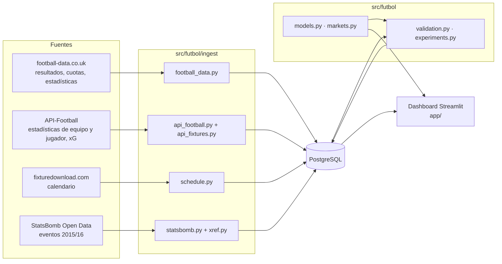

# Arquitectura

## Visión general



Tres capas con responsabilidades separadas:

1. **Ingesta** (`src/futbol/ingest/`, scripts en `scripts/`): descarga, normaliza y guarda en PostgreSQL. Es
   idempotente (volver a ejecutarla no duplica datos) y reanudable.
2. **Modelos y experimentos** (`src/futbol/`): funciones puras de pandas/numpy/scipy. Los experimentos leen de la base
   de datos y guardan sus predicciones en ella (`predictions`, `market_predictions`, `team_ratings`).
3. **Dashboard** (`app/`): solo lee y presenta. Lo único que calcula al vuelo es el ajuste del modelo de cada liga para
   el simulador y los próximos partidos (~50 ms, en caché una hora).

## Módulos

| Módulo | Responsabilidad |
|---|---|
| `config.py` | Configuración desde variables de entorno (`.env`); el único lugar que lee `os.getenv` |
| `db.py` | Motor de SQLAlchemy compartido, `COPY` masivo, *upsert*, ejecución del esquema |
| `leagues.py` | Registro de ligas: fuente, formato de temporada, calendario, id de API-Football |
| `ingest/football_data.py` | CSV de football-data (ligas principales y "extra"), selección de cuotas, partidos aplazados |
| `ingest/api_football.py` | Cliente de API-Football con limitador de peticiones; búsqueda de jugadores |
| `ingest/api_fixtures.py` | Descarga masiva de partidos (`/fixtures?ids=`), JSON en disco, tablas procesadas |
| `ingest/schedule.py` | Calendario de fixturedownload y alias de equipos |
| `ingest/statsbomb.py`, `ingest/xref.py` | Eventos de StatsBomb y cruce de equipos por calendario |
| `models.py` | Poisson / Dixon-Coles, matriz de marcadores, probabilidades 1X2, cuotas → probabilidades |
| `markets.py` | Córners, tarjetas, tiros, tiros a puerta, más/menos, apuestas de jugador, puntuación de mercados |
| `validation.py` | Backtest *walk-forward*, log loss, Brier, RPS, calibración |
| `experiments.py` | Experimentos guardados: varias temporadas, xG frente a goles, mercados, próximos partidos |
| `season.py` | Clasificación, forma, puntos esperados, fase regular de Liga MX |
| `api_stats.py` | Tablas de equipos y jugadores a partir de API-Football; frecuencias de líneas |
| `lineups.py` | Alineación probable a partir de las últimas alineaciones y el parte de bajas; su backtest |
| `ingest/api_matchday.py` | Próximos partidos, parte de bajas y fotos de jugadores (en caché en disco) |
| `betslip.py` | Lector de boletos: OpenCV, Tesseract, parser, evaluación |
| `metrics.py`, `viz.py` | Métricas de eventos de StatsBomb (PPDA, pases progresivos) y gráficos de cancha |

## Dashboard

```
app/Inicio.py          punto de entrada: configuración de página y navegación (st.navigation)
app/common.py          consultas en caché (st.cache_data / st.cache_resource) compartidas por las vistas
app/styles.py          reglas de color de las tablas (estado, divergente, secuencial)
app/match_card.py      ficha de partido: próximo (predicción) y jugado (estadísticas frente a predicción)
app/pitch.py           campo de fútbol en Altair con los dos onces; el clic en un jugador vuelve a la vista
app/views/*.py         una vista por página
```

Streamlit vuelve a ejecutar la vista completa en cada interacción, así que **toda consulta pasa por la caché** de
`common.py` (una hora). El botón *Recargar datos* de la barra lateral la vacía.

## Decisiones de diseño

- **PostgreSQL y no CSV:** consultas con ventanas temporales, claves e índices; y la app y los scripts comparten una
  única fuente de verdad.
- **Funciones puras separadas de la E/S:** las transformaciones (parsers, métricas, modelos) no tocan la red ni la
  base de datos, y por eso se prueban sin infraestructura.
- **Datos originales guardados:** el JSON de API-Football se conserva comprimido en disco antes de procesarlo, para
  poder extraer campos nuevos sin volver a descargar (y sin plan de pago).
- **La fecha forma parte de la identidad del partido:** en Liga MX y Argentina el mismo enfrentamiento se repite dentro
  de una temporada (torneos cortos y liguilla).
- **Validar antes de afirmar:** cada mercado que muestra la app lleva su veredicto del backtest; lo que no está
  validado (apuestas de jugador) lo dice.
